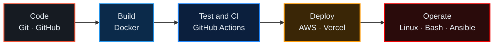

<div align="center">

# Shashwat Sharma

### Aspiring DevOps & Cloud Engineer


**Cloud infrastructure · Automation · Containerization · Reliable software delivery**

[](https://www.linkedin.com/in/shashwat-sharma-139b5a30b/)
[](mailto:onlyshashwat10@gmail.com)
[](https://github.com/Shashwatss10)
[](https://promithic-ai.vercel.app/)

[About](#about) · [Skills](#skills) · [Projects](#featured-projects) · [Labs](#devops-labs) · [Certifications](#certifications--training) · [Focus](#current-focus) · [Contact](#lets-connect)

</div>

---

## About

```bash
$ whoami
shashwat-sharma  # final-year B.Tech CSE · Arya College of Engineering & IT, Jaipur (RTU, Kota)

$ cat goal.txt
Entry-level DevOps / Cloud Engineer role

$ cat credentials.txt
RHCSA certified  ·  DevOps training at Grras Solutions Pvt. Ltd.
```

I'm a final-year Computer Science & Engineering student looking for an **entry-level DevOps / Cloud Engineer** role. I'm **RHCSA certified** and completed **DevOps training at Grras Solutions**. I'm building hands-on experience with Linux administration, containers, automation and AWS, with the goal of making software easier to build, ship and run reliably.

> I'm a fresher. I'd rather show you what I've built and learned than overstate it.

**The delivery pipeline I'm building skills around:**



---

## Skills

### Operating Systems & Administration


### Containers & Orchestration


### Cloud & Automation


### CI/CD & Version Control


### Networking & Web Infrastructure


### Programming & Databases


<sub>Badges marked "learning" are skills I'm actively developing, not claims of production experience.</sub>

---

## Featured Projects

### PromithicAI
[](https://github.com/Shashwatss10/PromithicAI)
[](https://promithic-ai.vercel.app/)

An AI web-app builder: describe an app, and a **Planner → Coder → Reviewer** agent pipeline generates the HTML/CSS/JS, streams it into an in-browser editor and previews it in a sandbox.

| | |
|---|---|
| **Stack** | HTML, CSS, vanilla JavaScript, Monaco Editor · FastAPI + LangGraph backend · Firebase Auth · Supabase (PostgreSQL) · Vercel |
| **Highlights** | Multi-agent pipeline with bounded retry loops · live token streaming (SSE) into Monaco · sandboxed iframe preview · Firebase-authenticated API with build history synced to Supabase · multiple LLM providers with bring-your-own-key and offline fallbacks |
| **Deployment** | Frontend deployed on Vercel. The repository documents a split deployment with the backend on Railway. |
| **DevOps relevance** | Environment-based configuration (`.env.example`), separate frontend/backend deployment, auth-domain configuration |
| **Planned next** | Containerize the backend, add a CI workflow, document the deployment architecture *(not yet built)* |

### Expense Tracker with Budget Insights
[](https://github.com/Shashwatss10/Expense-Tracker)

A full-stack personal finance app for tracking income and expenses, managing category budgets and exporting reports.

| | |
|---|---|
| **Stack** | React 18, Tailwind CSS, Recharts · FastAPI, SQLAlchemy · PostgreSQL / SQLite · Docker Compose |
| **Highlights** | Income and expense tracking with dashboard summary · category management and monthly budget alerts · analytics charts · PDF and CSV export · dark / light theme |
| **Deployment** | Runs locally; the repo includes a `docker-compose.yml`. No hosted demo yet. |
| **Planned next** | Dockerfiles per service, GitHub Actions for build and tests, hosted deployment with documentation *(not yet built)* |

---

## DevOps Labs

I'm starting a practical lab repository, **`devops-engineering-labs`**, to document hands-on work. Each lab will include the objective, commands, validation steps, common errors and what I learned.

| Track | Status |
|---|---|
| Linux / RHCSA practice | Planned |
| Bash scripting | Planned |
| Docker & Compose | Planned |
| Kubernetes basics | Planned |
| Ansible | Planned |
| AWS fundamentals | Planned |
| CI/CD with GitHub Actions | Planned |
| Troubleshooting | Planned |

---

## Certifications & Training

| Credential | Type | Issuer |
|---|---|---|
| **Red Hat Certified System Administrator (RHCSA)** | Professional certification (2025) | Red Hat |
| **DevOps Training** | Training program (Jan – Apr 2026) | Grras Solutions Pvt. Ltd. |

---

## GitHub Snapshot

[](https://github.com/Shashwatss10?tab=followers)
[](https://github.com/Shashwatss10/PromithicAI/stargazers)
[](https://github.com/Shashwatss10/Expense-Tracker/stargazers)
[](https://github.com/Shashwatss10/PromithicAI/commits/main)

---

## Current Focus

- **Linux** administration and troubleshooting
- **Docker** and container networking
- **Kubernetes** fundamentals
- **AWS** infrastructure and security basics
- **Ansible** automation
- **CI/CD** pipelines with GitHub Actions
- Reliable, repeatable application deployment

---

## Let's Connect

I enjoy turning manual steps into repeatable, reliable processes, and I'm eager to keep learning on a real team.

<div align="center">

[](https://www.linkedin.com/in/shashwat-sharma-139b5a30b/)
[](mailto:onlyshashwat10@gmail.com)
[](https://github.com/Shashwatss10)

</div>
